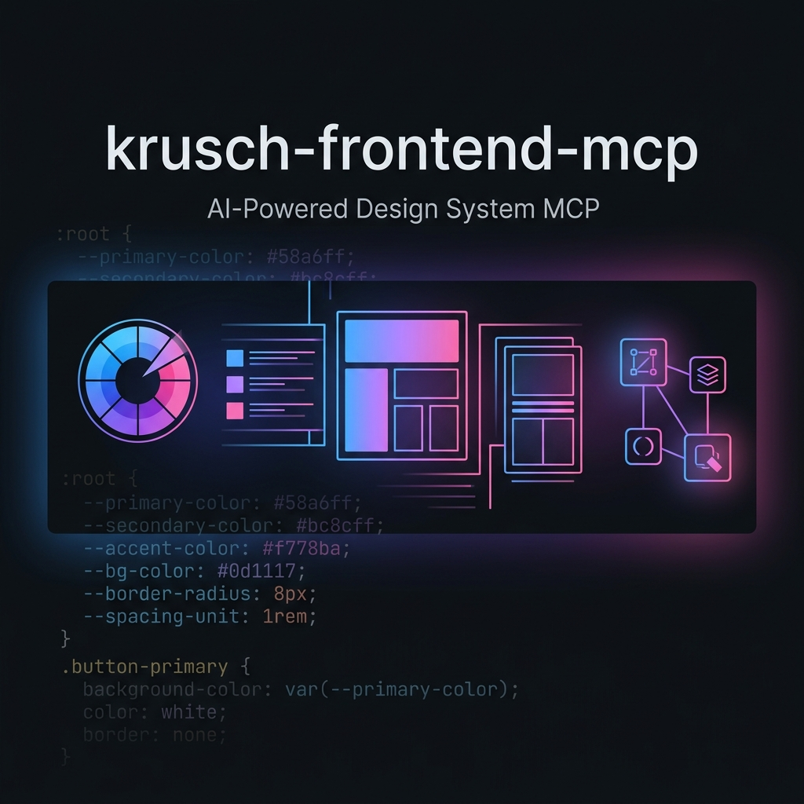

<p align="center">
  
</p>

# krusch-frontend-mcp

> Give your AI agent a design eye — MCP tools for color theory, layout analysis, canonical component templates, and design system enforcement.

[](https://nodejs.org/)
[](LICENSE)
[](https://modelcontextprotocol.io/)
[](#architecture)
[](#development)
[](https://m8ven.ai/mcp/kruschdev/krusch-frontend-mcp?s=readme)

AI-powered styling assistant [MCP server](https://modelcontextprotocol.io/) that provides deterministic design utilities, canonical HTML/SVG/Vercel layout primitives, and Hybrid RAG-backed design rule retrieval for autonomous frontend development.

## Features

- **12 MCP tools** — deterministic CSS/color algorithms, canonical component & Vercel templates, provenance graph traversal, and LLM-assisted generation
- **48 curated design rules** — WCAG accessibility, Refactoring UI heuristics, Vercel Next.js App Router / Edge streaming patterns, typography, and spacing
- **Canonical template substrate (16 templates)** — bit-for-bit HTML/SVG brand primitives (`article-shell`, `site-header`, `footer-deadbolt`, `deadbolt-svg`, `cyber-grid`, `nav-back`) and `@krusch/toolkit` + Vercel Lego bricks (`lego-vercel-nextjs-shell`, `lego-vercel-edge-sse`, `lego-vercel-json`, etc.) preventing ad-hoc layout drift
- **Figma token ingestion** — parse design system JSON directly into CSS custom properties or the RAG store
- **Hybrid `sqlite-vec` + SQLite `FTS5` (`BM25`) RRF** — combines `1024d` cosine similarity with lexical `BM25` search via Reciprocal Rank Fusion, with automatic zero-network `FTS5` fallback when offline
- **Fleet-aware Ollama routing** — optional multi-node load balancing for embeddings

## Requirements

- **Node.js 22+**
- **[Ollama](https://ollama.ai/)** running locally (or on a remote host; optional for deterministic tools and offline `FTS5` rule retrieval)
- Recommended Ollama models:
  - `snowflake-arctic-embed2` — `8,192`-ctx `1024`-dim embedder for design rules and tokens (or configurable `EMBED_MODEL`)
  - `qwen2.5-coder:7b` — for layout analysis and component style generation (or configurable `LLM_MODEL`)

```bash
ollama pull snowflake-arctic-embed2
ollama pull qwen2.5-coder:7b
```

## Installation

```bash
git clone https://github.com/kruschdev/krusch-frontend-mcp.git
cd krusch-frontend-mcp
npm install
```

### Seed the RAG store

On first run, seed the database with 48 curated design rules:

```bash
npm run seed
```

This is idempotent — running it again safely replaces existing rules.

## Configuration

All configuration is via environment variables. Create a `.env` file or export them directly:

| Variable | Default | Description |
|----------|---------|-------------|
| `OLLAMA_URL` | `http://localhost:11434` | Primary Ollama instance URL |
| `OLLAMA_NODES` | *(derived from OLLAMA_URL)* | Comma-separated `host:port` list for fleet routing |
| `EMBED_MODEL` | `snowflake-arctic-embed2` | Ollama model for embeddings |
| `EMBED_DIMENSION` | `1024` | Embedding vector dimension |
| `LLM_MODEL` | `qwen2.5-coder:7b` | Ollama model for layout and component style generation |
| `DEBUG` | `false` | Enable debug logging |

### Multi-node Ollama fleet

If you have multiple Ollama instances, set `OLLAMA_NODES` for round-robin load balancing on embedding operations:

```bash
export OLLAMA_NODES="localhost:11434,gpu-server:11434,inference-node:11434"
```

## Usage with Claude Desktop / Cursor / etc.

Add to your MCP client configuration:

```json
{
  "mcpServers": {
    "krusch-frontend-mcp": {
      "command": "node",
      "args": ["/absolute/path/to/krusch-frontend-mcp/src/index.js"]
    }
  }
}
```

## Tools (12 Tools)

### Deterministic & Canonical Primitives (no LLM required)

| Tool | Description |
|------|-------------|
| `generate_color_palette` | HSL math palette generation from a base hex code with WCAG contrast scoring |
| `css_to_tailwind` | AST-based CSS → Tailwind class mapping (~230 entries + shorthand expansion) |
| `generate_css_variables_from_figma` | Parse Figma JSON tokens into a CSS `:root` block with custom properties |
| `generate_responsive_breakpoints` | CSS media query generation with customizable breakpoint widths |
| `get_canonical_template` | Retrieve 16 authoritative HTML/SVG, Vercel Next.js/Edge, & `@krusch/toolkit` Lego templates (`article-shell`, `site-header`, `footer-deadbolt`, `deadbolt-svg`, `cyber-grid`, `nav-back`, `lego-node-api`, `lego-mcp-server`, `lego-sse-route`, `lego-react-shell`, `lego-fastapi-app`, `lego-cloudflare-worker`, `lego-webhook-route`, `lego-vercel-nextjs-shell`, `lego-vercel-edge-sse`, `lego-vercel-json`) |
| `list_canonical_templates` | List all 16 available canonical HTML/SVG brand primitives, Vercel bricks, and Lego code starter templates |

### RAG & Provenance Lineage (SQLite FTS5 + sqlite-vec)

| Tool | Description |
|------|-------------|
| `ingest_figma_tokens` | Embed and store Figma JSON tokens in the vector database |
| `query_design_rules` | Hybrid semantic + lexical `BM25` search over 48 curated design rules with optional paradigm filter |
| `frontend_get_provenance` | Trace version history and provenance of a design rule or token in SQLite |
| `frontend_traverse_graph` | Traverse parent/child lineage graphs for frontend design rules |

### LLM-assisted (requires Ollama for inference)

| Tool | Description |
|------|-------------|
| `analyze_layout_structure` | HTML → CSS layout analysis (Flexbox vs Grid recommendation) |
| `generate_component_styles` | RAG-enriched component style generation from natural language descriptions |

### Design Rule Paradigms

The `query_design_rules` and `generate_component_styles` tools support an optional `paradigm` filter:

- **`universal`** (35 rules) — WCAG accessibility, spacing scales, typography, color systems, layout patterns, animation timing
- **`refactoring-ui`** (7 rules) — Heuristics from Refactoring UI: hierarchy through weight, de-emphasized borders, visual alignment
- **`vercel`** (6 rules) — Vercel Next.js App Router SSR hydration safety (`useMounted`), unbuffered Edge SSE streaming (`force-dynamic`, `no-transform`), Web-Standards Edge runtime purity, zero-CLS font/SVG sizing, and `vercel.json` security headers

## Development

```bash
# Run tests (48 cases)
npm test

# Seed RAG store (idempotent)
npm run seed

# Start MCP server (stdio mode)
npm start
```

## Architecture

```
krusch-frontend-mcp/
├── src/
│   ├── index.js           # MCP server entrypoint (stdio transport)
│   ├── config.js           # Environment-based configuration
│   ├── rag-engine.js       # sqlite-vec vector store + paradigm-aware search
│   ├── lib/
│   │   ├── db.js           # Standalone better-sqlite3 wrapper
│   │   └── llm.js          # Minimal Ollama chat client
│   └── tools/
│       ├── color.js        # HSL/Hex math — palette generation + WCAG contrast
│       ├── tailwind.js     # AST-based CSS → Tailwind class mapping
│       ├── figma.js        # Figma JSON token ingestion + CSS variable generation
│       ├── design-rules.js # RAG-powered design rule retrieval
│       ├── layout.js       # LLM HTML → CSS layout analysis
│       ├── embed.js        # Ollama embedding client (fleet-aware)
│       ├── breakpoints.js  # Responsive breakpoint generator
│       └── component-styles.js # LLM-assisted component style generation
├── scripts/
│   ├── seed-utils.js              # Shared seeding utility
│   ├── seed-design-rules.js       # 29 universal baseline rules
│   ├── ingest-refactoring-ui.js   # 7 Refactoring UI aesthetic rules
│   └── ingest-universal-a11y.js   # 6 extended WCAG/ARIA rules
└── tests/                         # 27 test cases (node:test)
```

## License

MIT
